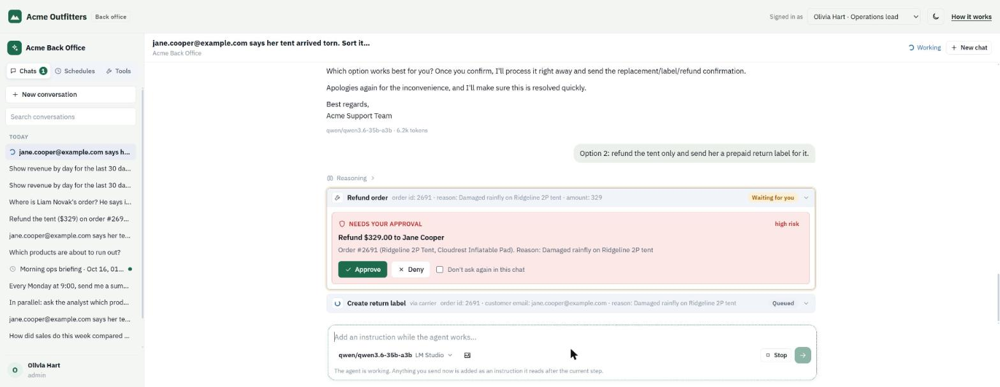
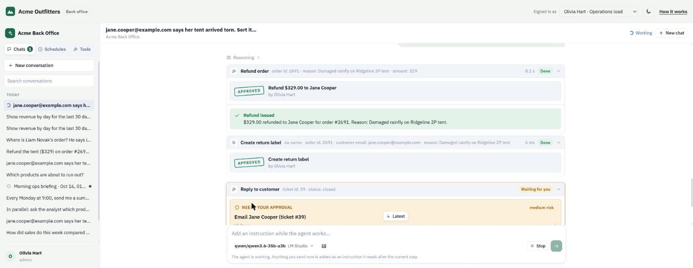
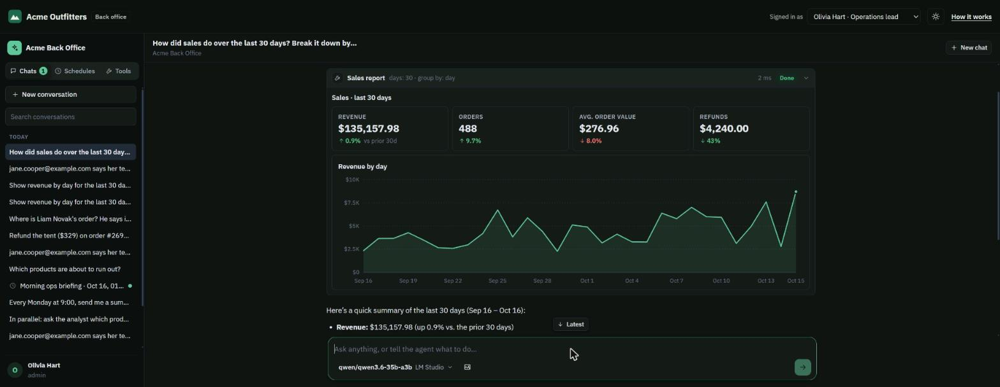
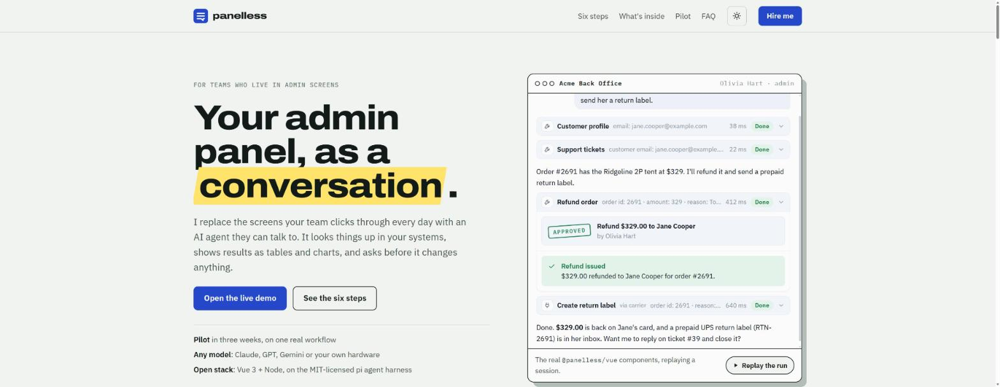
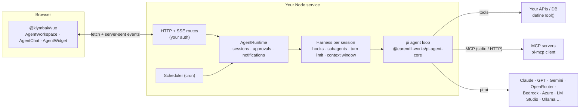

# Klymbak

**Replace an internal admin panel with an AI agent that lives in a chat.**

Staff ask for what they need ("Jane's tent arrived torn, refund it and send a return label"). The agent looks things up through your existing systems, shows results as tables and charts, and **stops for a person's approval before it changes anything**.

This repository is a complete, working reference build:

- **`@klymbak/server`**: an agent harness for Node built on the MIT-licensed [pi](https://github.com/earendil-works/pi) agent loop. It adds typed tools, MCP servers, lifecycle hooks, human approvals, specialist subagents, scheduled tasks, sessions, and an HTTP + SSE API.
- **`@klymbak/vue`**: Vue 3 components: a full workspace, a single chat, or a floating widget. They include streaming, tool cards, approval prompts, subagent traces, generative UI (tables, charts, stat tiles), a model/provider picker and schedules.
- **`@klymbak/react`**: the same workspace, chat and floating widget for React 18 and 19, on the same store and stylesheet.
- **`@klymbak/angular`**: the same again for Angular 21 and 22, as standalone components with signals.
- **`@klymbak/strapi`**: a Strapi 5 plugin. The assistant works with content as the signed-in admin, within their role's permissions, from a page in the admin, a side panel in the edit view and a bulk action in the list view.
- **A realistic demo**: the back office of "Acme Outfitters", an outdoor-gear store with SQLite data, 16 tools, a separate carrier **MCP server**, policy hooks, three subagents and scheduled briefings.
- **An explainer site** that walks a client through the six steps of bringing an agent into their product.



| | |
|---|---|
|  |  |



---

## Quick start

Requirements: **Node 22.19+** (uses the built-in `node:sqlite`) and **pnpm 10**.

```bash
pnpm install
cp apps/acme-api/.env.example apps/acme-api/.env   # add at least one API key, or run a local model
pnpm dev                                           # API on :8787, console on :5173
pnpm dev:site                                      # explainer site on :5174
pnpm dev:react                                     # API + React playground on :5175
pnpm dev:angular                                   # API + Angular playground on :5176
pnpm dev:strapi                                    # Strapi 5 blog with the plugin on :1337 (see apps/strapi-demo)
```

Open <http://localhost:5173>. The model picker lists every model whose provider is configured:

- **Cloud**: set `ANTHROPIC_API_KEY`, `OPENAI_API_KEY`, `GEMINI_API_KEY`, `OPENROUTER_API_KEY`, … (any provider pi supports).
- **Local**: start [LM Studio](https://lmstudio.ai) or [Ollama](https://ollama.com); models are discovered automatically. Load a tool-capable model with **at least 16k context** (e.g. `lms load qwen/qwen3.6-35b-a3b --context-length 32768`). The demo was developed against Qwen 3.6 35B-A3B in LM Studio.

The demo database is generated on first start, with dates relative to today. Reset it with `pnpm --filter acme-api seed` or the `POST /api/demo/reset` endpoint.

### Things to try

| Prompt | What it shows |
|---|---|
| *How did sales do this week compared with last week?* | Stat tiles + chart rendered from tool output; the model reads only a summary |
| *jane.cooper@example.com says her tent arrived torn. Sort it out.* | Multi-step investigation, parallel lookups, refund + return label behind approvals |
| *Where is Liam Novak's order? He says it's stuck.* | The carrier **MCP server**, rendered by a custom Vue component |
| Type `/`, pick *Delay notice*, or `@` and pick *Return policy* or *Shipment* | The carrier server's **MCP prompts, resources and templates** in the message box, with tracking numbers suggested as you type |
| *Ask the analyst and the inventory planner in parallel…* | Two **subagents** running concurrently, nested in the transcript |
| *Every Monday at 9:00, send me a summary of last week's refunds* | The agent creates a **scheduled task** from chat |
| Switch to **Marcus (Support)** and refund a $448 order | A **policy hook** blocks it: support can refund up to $150 |
| Switch to **Priya (Analyst)** and list top customers | A **PII hook** masks emails and phones for that role |
| Deny an approval with a reason | The agent reads your reason and changes course |
| Schedules → *Morning ops briefing* → **Run now** | An unattended run that posts to `#ops` and notifies you |
| Schedules → *Draft replies to open tickets* → **Run now**, then switch to **Marcus (Support)** | The **approval inbox**: rewrite a drafted reply before it goes out, deny another with a reason, and the run carries on; each reply follows the **knowledge base**'s policies and how similar tickets were resolved |
| *Does the Ridgeline 3P footprint fit the 2P? What's our warranty on zippers?* | **Knowledge**: a lookup in the parts table, and a policy answered from the handbook with its sources cited |

---

## Architecture



**What pi provides** (MIT): the agent loop (`Agent`), tool execution with `beforeToolCall`/`afterToolCall`, steering and follow-up queues, 40+ model providers with streaming, cost tracking and thinking levels, and a dependency-free MCP client.

**What this repo adds on top**: tool definitions with approvals, roles and UI output; Claude-Code-style lifecycle hooks; an approval broker; subagent delegation with nested event streams; a cron scheduler for unattended runs; persistent sessions; a wire protocol with a shared reducer; a framework-agnostic client store; and the Vue, React and Angular UIs.

```
packages/
  protocol/   wire types, generative-UI blocks, the event reducer, an SSE parser (no dependencies)
  server/     the harness: runtime, tools, hooks, approvals, MCP, subagents, scheduler, storage, HTTP
  client/     framework-agnostic browser side: the API client, the chat store, formatting, Markdown, the stylesheet
  vue/        Vue 3 components over the client store
  react/      React components over the client store
  angular/    Angular components over the client store
  strapi/     Strapi 5 plugin: the agent in-process, content tools that act as the signed-in admin, admin UI
apps/
  acme-api/        demo back end: SQLite store, 16 tools, policy hooks, subagents, schedules
  carrier-mcp/     demo MCP server (stdio): shipment tracking, quotes, return labels
  acme-console/    demo front end: AgentWorkspace with Acme branding and a custom tool renderer
  react-console/   React playground against the same demo API
  angular-console/ Angular playground against the same demo API
  strapi-demo/     Strapi 5 blog (articles, authors, categories) with the plugin installed
  site/            explainer site
```

---

## Add it to your app

### 1. Server

```ts
import { createAgentServer, defineTool, Type, ui, auditTrail, lmStudio } from "@klymbak/server";

const listOrders = defineTool({
  name: "list_orders",
  description: "Search orders by status or customer email.",
  readOnly: true,
  parameters: Type.Object({ status: Type.Optional(Type.String()), email: Type.Optional(Type.String()) }),
  execute: async (args, ctx) => {
    const rows = await db.orders.search(args, { as: ctx.user });  // runs as the signed-in person
    return {
      text: `${rows.length} orders: ${rows.map((r) => `#${r.id} ${r.status}`).join(", ")}`, // what the model reads
      ui: ui.table({ title: "Orders", columns: [{ key: "id", label: "Order" }, { key: "total", label: "Total", format: "currency" }], rows }), // what people see
    };
  },
});

const agent = createAgentServer({
  systemPrompt: "You are the back-office agent for …",
  models: { providers: ["anthropic", "openai"], custom: [lmStudio()], default: "anthropic/claude-sonnet-5-5" },
  tools: [listOrders, refundOrder],
  mcpServers: { stripe: { url: "https://mcp.stripe.com", headers: { authorization: `Bearer ${process.env.STRIPE_KEY}` }, approval: true } },
  hooks: [auditTrail((entry) => audit.write(entry))],
  auth: async (request) => sessions.userFrom(request), // null → 401
});

// Hono / Bun / Deno / Cloudflare:  app.route("/api/agent", agent.app)
// Express / Node http:            app.use("/api/agent", agent.nodeHandler)
await agent.start();
```

### 2. Client

```vue
<script setup lang="ts">
import { AgentWorkspace } from "@klymbak/vue";
import "@klymbak/vue/style.css";
</script>

<template>
  <AgentWorkspace base-url="/api/agent" />
  <!-- or <AgentChat base-url="/api/agent" />, or the floating <AgentWidget base-url="/api/agent" /> -->
</template>
```

Or install it once with `app.use(Klymbak, { baseUrl: "/api/agent", headers: () => ({ authorization: … }) })` and use the components anywhere. React and Angular work the same way: `<KlymbakProvider baseUrl="/api/agent">` in [`@klymbak/react`](packages/react), `provideKlymbak({ baseUrl: "/api/agent" })` and `<kl-agent-workspace />` in [`@klymbak/angular`](packages/angular). Re-skin with CSS variables (`--kl-accent`, `--kl-radius`, `--kl-font`, …); the demo console's [theme.css](apps/acme-console/src/theme.css) is the whole branding layer.

To chat about what is on screen, pass it as `context` (`<AgentChat context="Order #1042 is open" />`, or `store.setContext(…)`): it goes to the model with every message and never shows in the transcript.

### On Strapi

Install the [plugin](packages/strapi) instead: `npm install @klymbak/strapi`, add a model key, and the assistant appears in the admin menu, in the edit view and in the list view's bulk actions.

---

## Concepts

### Tools

`defineTool({ name, description, parameters, execute })`, with parameters as a TypeBox schema (re-exported as `Type`). Arguments are validated before `execute` runs. A tool returns a string or `{ text, data, ui, isError, images }`:

- `text` is what the model reads. Keep it compact; it is truncated past 24k characters.
- `ui` blocks go only to the browser: `table`, `stats`, `chart` (bar/line/area), `keyvalue`, `media` (images and videos as previews, other files as tiles that open them), `sources` (citations: documents with links, where in them, and the passage), `markdown`, `alert`, `actions` (buttons that send a prompt or emit an event to your app) and `custom` (your own Vue component). A 500-row table costs no tokens.
- Options: `label` (the tool card's name) and `summary` (what the Tools panel says it does, in place of the description written for the model), each a string or a function of the person's locale; `approval` (boolean or a function of the arguments returning `{ title, description, risk, edit }`), `roles`, `readOnly`, `sequential`, `maxResultChars`.

`ctx` gives every tool the signed-in `user`, `sessionId`, `signal`, `headless` (unattended) and `progress(text)` for live status lines.

### Human approval

When a tool needs approval, the run pauses and the UI shows a card with the exact action. **Approve**, **Deny with a reason** (the model reads it), or **Don't ask again in this chat**. Approvals expire (default 15 min).

In unattended runs (schedules, and `runHeadless` from your own code) nobody is there to click, so the run ends at the approval and waits. The call is stored with the session, its card shows in the conversation, and everyone who can see the session gets a notification. Approving or denying it, hours later or after a restart, resumes the session as a new run. Denied calls tell the model why. An approved call runs as the person who approved it: the tool's `roles`, the policy hooks and the tool itself see them, with `ctx.headless` false, so it takes someone who may use the tool to approve it. The model then carries on as the run's own user. When one step asks for several approvals, the run resumes once all of them are decided, and new messages in that conversation wait until then. Delegated tasks can't pause inside the parent's call, so subagents still refuse approvals in unattended runs.

Policy hooks run when the run asks, as the run's user with `ctx.headless` true, and again when an approved call runs, as the approver. A limit that depends on who acts, such as "support refunds up to $150", can return `{ decision: "ask" }` while `ctx.headless` is true and leave the check to the approver.

A tool can let the person deciding rewrite some of its text arguments first, such as a drafted reply: `approval: () => ({ title: "Email Jane", edit: [{ name: "message", label: "Reply" }] })`. The card shows each one as a field holding the agent's draft. The call runs with the person's version, the card says it was edited, and the model is told what changed, while its transcript keeps what it asked for. Only text arguments can be edited, and an edit the tool's parameters reject is refused before anything runs. A `preToolUse` hook can add `edit` through its `approval`, for MCP tools.

**The approval inbox** lists what unattended runs left waiting for each person, across conversations, oldest first: in sessions they can see (their own, or with a role in the session's `audience`) and for tools their roles may use. `AgentWorkspace` offers it in the sidebar, with a count, while something waits, and it is also a component of its own (`ApprovalInbox`, `<kl-approval-inbox>`) for a page of its own. A chat's own approvals stay in that chat, with the person watching it.

### Hooks

Hooks follow Claude Code's lifecycle and run in registration order:

| Hook | Use it to |
|---|---|
| `sessionStart` | add context to a new conversation (e.g. a live business snapshot) |
| `userPromptSubmit` | refuse a prompt, rewrite it, or attach hidden context |
| `preToolUse` | `deny` (policy), `ask` (force approval) or `allow` (skip the tool's own approval). Any deny wins, then ask, then allow. A hook that throws blocks the call (fails closed). |
| `postToolUse` | rewrite results, e.g. mask PII for some roles (changes both model text and UI) |
| `stop` | send the agent one more instruction before it finishes |
| `runEnd` / `onEvent` | telemetry, audit, analytics |

Built in: `requireApproval({ tools })`, `redactPii({ roles })`, `auditTrail(sink)`. See [apps/acme-api/src/hooks.ts](apps/acme-api/src/hooks.ts) for the refund policy, business snapshot, audit log and telemetry used by the demo.

### MCP servers

```ts
mcpServers: {
  carrier: { command: "node", args: ["carrier-server.js"], approval: ["create_return_label"] }, // stdio
  zendesk: { url: "https://mcp.example.com/mcp", headers: { authorization: "Bearer …" }, roles: ["support"] }, // Streamable HTTP
}
```

Tools appear as `<server>_<tool>`. MCP annotations are honoured (`readOnlyHint`, and `destructiveHint` asks for approval). `approval`, `readOnly`, `include` and `exclude` take a list of tool names or a function, for servers whose tools carry no annotations: `approval: (name) => !/^(list|get)_/.test(name)`. Tool-list changes are picked up live. Structured results render automatically: files (records with a `url` and a MIME type, such as Strapi's media library) as a gallery, other lists of records as tables. You can register a Vue renderer per tool (the demo's shipment timeline). With `runtimeMcp: true`, admins can also connect HTTP MCP servers from the **Tools** panel.

A server's **resources** and **prompts** come to the chat by themselves. Typing `@` in the message box lists the resources: a chosen one shows as a chip, and the server reads it when the message is sent, so the model gets its contents (marked as data, not instructions) and the transcript shows its name. Resource templates (`orders://{id}`) are in the same list and ask for a value for each variable. Typing `/` at the start of a message lists the prompts: choosing one asks for its arguments, and its text opens the message, before anything the person types. When a server supports MCP completions, the fields for arguments and variables suggest values as people type. A resource that can't be read or a missing required value refuses the message before the run starts. The **Tools** panel lists each server's prompts and resources too.

The model can read resources itself: `list_resources` and `read_resource` are there for anyone who may use a server with resources, and a resource link in a tool's result names its server so the model can follow it. Everything follows the server's `roles`, lists stay current when a server says they changed, and `resources: false` or `prompts: false` turns them off for a server.

### Subagents

```ts
subagents: [{ name: "analyst", description: "Sales trends and ad-hoc SQL", systemPrompt: "…", tools: ["sales_report", "query_database"] }]
```

The main agent gets a `delegate_task` tool. Specialists get a fresh context and a narrower tool set, run in parallel when delegated together, use the same approval flow, and stream their steps nested under the delegating card.

### Skills

```ts
import { loadSkills } from "@klymbak/server";

skills: [
  ...(await loadSkills("./skills")), // skills/<name>/SKILL.md, plus any documents it refers to
  { name: "refund-policy", description: "When and how much we refund. Use for any refund request.", instructions: "…", roles: ["support"] },
]
```

Procedures and house rules: how we write an article, what to check before publishing, the refund policy. They use Anthropic's [Agent Skills](https://agentskills.io) format, a folder per skill with a `SKILL.md` (frontmatter `name` and `description`, then Markdown). Only each skill's name and description go into the prompt. The agent loads a skill's text with the `use_skill` tool when a task matches, and reads the documents it refers to (Markdown, text, CSV, JSON or YAML in the folder) the same way. `roles` limits who sees a skill. Scripts in a skill folder are ignored: nothing runs them.

### Knowledge

Skills say how to do something; knowledge holds the facts: policies, manuals, help-center articles, how past tickets were resolved, which part fits which model. `knowledgeTools` gives the agent tools to search and read it:

```ts
import { knowledge, knowledgeTools, openAIEmbeddings } from "@klymbak/server";

tools: [
  ...knowledgeTools({
    description: "Acme's policies, product manuals and resolved support tickets",
    sources: [
      knowledge.folder("./knowledge"),                                    // Markdown, HTML, text and PDF files
      knowledge.llmsTxt("https://docs.example.com/llms.txt"),             // a docs site's llms.txt, with llms-full.txt's text
      knowledge.sitemap("https://help.example.com/sitemap.xml"),          // a website's pages
      knowledge.documents({ name: "articles", load: () => helpdesk.articles() }), // anything your code loads
      knowledge.tickets({ load: () => helpdesk.resolvedTickets(), roles: ["support"] }),
      knowledge.table({ name: "parts", description: "Which spare part fits which product", file: "./parts.csv" }), // CSV or .xlsx
    ],
    cacheDir: "./data/knowledge",
  }),
]
```

- **`search_knowledge`** searches every source section by section: documents are split at their headings (PDFs by page), and titles, headings, summaries and text are scored with stemmed keywords (BM25F), code samples counting little. It returns the best passages with their document ids, and a `sources` block shows people each passage and a link to check it.
- **`read_knowledge`** reads a document, a long one as its outline first and then one section at a time.
- **`lookup_knowledge`**, when there are tables, finds rows by column value, ignoring case and punctuation, with items of lists in a cell and number comparisons (`">= 40"`). For "does part X fit model Y" a lookup is exact where search would guess, and when no row matches it suggests the closest values.

**Resolved tickets** carry other customers' names, addresses and orders, and a reply drafted from them must not pass those on. `knowledge.tickets` replaces each ticket's customer (name, also in parts, email, phone, address, and the `private` values you list, such as order and tracking numbers) and any email, phone or card number with placeholders before the ticket is indexed, so neither search nor the model ever sees them. Names it isn't told about stay, so limit the source with `roles` too. `redact: false` keeps the details, for sources only some roles may use.

**Semantic search** is optional: with `embeddings`, passages are embedded when they load and both rankings are merged, so a question finds the passage that says the same thing in other words ("my order never showed up" finds "Where is my order?"). `openAIEmbeddings({ baseUrl, model })` works with OpenAI, LM Studio, Ollama or any compatible endpoint. Turn it on when an eval of past tickets shows search missing articles that exist.

Sources load on first use. Remote ones refresh daily, and with `cacheDir` a copy is kept for when a site can't be reached, along with the embeddings. `roles` on a source limits who searches it. What the agent reads is marked as data, not instructions, since documents and tickets can carry text anyone wrote. The tools' names follow `name` (`search_<name>`, …), which is how the Strapi plugin's `search_strapi_docs` is built on the same tools.

### Scheduled tasks

Define them in config (`schedules: [{ id, name, cron, prompt, agent?, audience? }]`), create them in the **Schedules** panel, or ask the agent ("every weekday at 8, …"). Each run is an unattended session owned by the schedule's owner. People in its audience see the result and get a notification.

### Jobs from your own code

Besides people in the admin panel and schedules, your app can hand the agent a job from its own code, such as a pending task on the server, a background check or a step in a queue. `runHeadless` runs it unattended:

```ts
const outcome = await agent.runtime.runHeadless({
  user: requestedBy,
  audience: ["support"],
  title: `Refund request for order #${order.id}`,
  prompt: "Check whether this order qualifies for a refund, and refund it if it does.",
  context: JSON.stringify(order),
});
// { sessionId, status, text, usage }, once the run ends or stops to wait for an approval
```

The run is a session like any other. `user` owns it, people with a role in `audience` see it in their list, and it stays unread until someone opens it. `context` reaches the model only, marked as data rather than instructions, since records can carry text anyone wrote. People see the prompt.

`user` is whoever the job acts for. When the job belongs to someone, such as the person who queued it, run it as them, with their permissions. When it belongs to nobody, give it a service identity of its own whose role allows only what the job needs. An action that needs approval waits for someone in the audience (see [Human approval](#human-approval)).

### Languages

The components come in 12 languages besides English (`locale` and `messages`, see [`@klymbak/client`](packages/client#languages)), and the server writes what people read in their language too: tool names and summaries in the Tools panel, approval titles, refusals, notices and errors. The components send their `locale` as `Accept-Language`, and the server puts it on `ctx.user.locale`, unless `auth` set one already. What the model reads (the prompt, tool descriptions and results) stays English; the model answers in the language people write in.

```ts
import { createTranslator, defineTool } from "@klymbak/server";

const t = createTranslator(
  { label: "Refund order", title: "Refund {amount} on order {id}" },
  { de: { label: "Bestellung erstatten", title: "{amount} für Bestellung {id} erstatten" } },
);

defineTool({
  name: "refund_order",
  label: (locale) => t(locale, "label"),
  approval: (args, ctx) => ({ title: t(ctx.user.locale, "title", args) }),
  // …
});
```

`t` picks the closest language ("de-AT" gets `de`) and falls back to English message by message. Messages use the same ICU MessageFormat basics as the components' catalogs. A schedule keeps its owner's language for its unattended runs, and the model is asked to write their report in it.

### Models and providers

`models.providers` enables any [pi-ai](https://www.npmjs.com/package/@earendil-works/pi-ai) provider. It is listed only when credentials are present, filtered by `allow` globs. `custom` adds any OpenAI-compatible endpoint, with presets `lmStudio()` and `ollama()` that discover models (LM Studio's API also reports context length and tool support). People pick the model and thinking level per conversation, and every answer reports its tokens and cost.

### Sessions, streaming and steering

Sessions persist through an `AgentStorage` adapter (`memoryStorage()`, `fileStorage(dir)`, or your database). A run streams typed events over SSE; the same `applyEvent` reducer builds the transcript on the server (for storage and reconnects) and in the browser. Reload mid-run and the UI re-attaches. While the agent works, anything typed is sent as a **steering** message that it reads after the current step.

<details>
<summary>HTTP API</summary>

| Method | Path | |
|---|---|---|
| GET | `/config` | models, tools, subagents, MCP servers, resources, resource templates and prompts, features for the current user |
| GET / POST | `/sessions` | list / create |
| GET / PATCH / DELETE | `/sessions/:id` | read (with transcript) / rename, change model / delete |
| POST | `/sessions/:id/runs` | start a run, with MCP `resources` and an `mcpPrompt` if any; the response is an SSE stream until `run_end` |
| GET | `/sessions/:id/stream` | snapshot + live events (reconnect) |
| POST | `/sessions/:id/abort`, `/steer`, `/approvals/:approvalId` | stop, steer, decide (with `edits` to an approval's fields) |
| GET | `/approvals` | the approval inbox: what unattended runs left waiting that the caller may decide |
| GET / POST / PATCH / DELETE | `/schedules[/:id]`, POST `/schedules/:id/run` | scheduled tasks |
| GET / POST / DELETE | `/mcp[/:name]` | integrations |
| POST | `/mcp/complete` | values a server suggests for a prompt's argument or a resource template's variable |
| GET | `/events` | notifications (schedule results, approvals waiting and decided, session list) |

</details>

---

## Development

```bash
pnpm test        # protocol, harness (with pi's scripted faux provider), HTTP API, scheduler, client store, Vue, React and Angular components, the Strapi plugin
pnpm typecheck
pnpm build       # libraries to dist/, demo console and site to static files
pnpm test:strapi # builds the Strapi plugin and demo, then runs the content tools as different roles in a real Strapi
```

CI (`.github/workflows/ci.yml`) runs these on every push and pull request, plus `strapi-plugin verify` and the demo's admin panel build with the plugin in it.

In development the workspace packages resolve to their TypeScript sources through a custom export condition (`@klymbak/source`), so there is no build step between editing the library and seeing it in the demo.

## Deploying the demo

The API serves the built console, so the demo deploys as one service:

```bash
docker build -t klymbak-demo .
docker run -p 8787:8787 -e ANTHROPIC_API_KEY=… klymbak-demo
```

The explainer site is static (`pnpm --filter site build` → `apps/site/dist`). Its copy, in every language, comes from the Strapi CMS at strapi.berezhnyk.com when the build has `STRAPI_TOKEN` (a read-only API token; `STRAPI_URL` points elsewhere), and from the committed `apps/site/cms/snapshot.json` otherwise. Refresh that snapshot with `pnpm --filter site content:pull`. English lives at `/`, other languages at `/<code>/` once their home page is published. Set `VITE_DEMO_URL` at build time to show the demo buttons.

It runs on Cloudflare Workers at klymbak.ai (`apps/site/wrangler.jsonc`). Connect the repo under Workers → Import a repository with the build command `pnpm --filter site build` and the deploy command `pnpm --filter site run deploy` (keep `run`: bare `pnpm deploy` is a built-in pnpm command), or run the same two steps locally after `pnpm --filter site exec wrangler login`.

## Roadmap

The Strapi plugin has shipped. Next is work that starts from an incoming ticket rather than a chat: approvals that wait for a person, a knowledge base, and helpdesk and store adapters. Which products to integrate with first is being re-evaluated. The full list, and the reasoning behind the order, is in [ROADMAP.md](ROADMAP.md).

## License

MIT. pi (`@earendil-works/pi-*`) is MIT-licensed by Mario Zechner and contributors.
